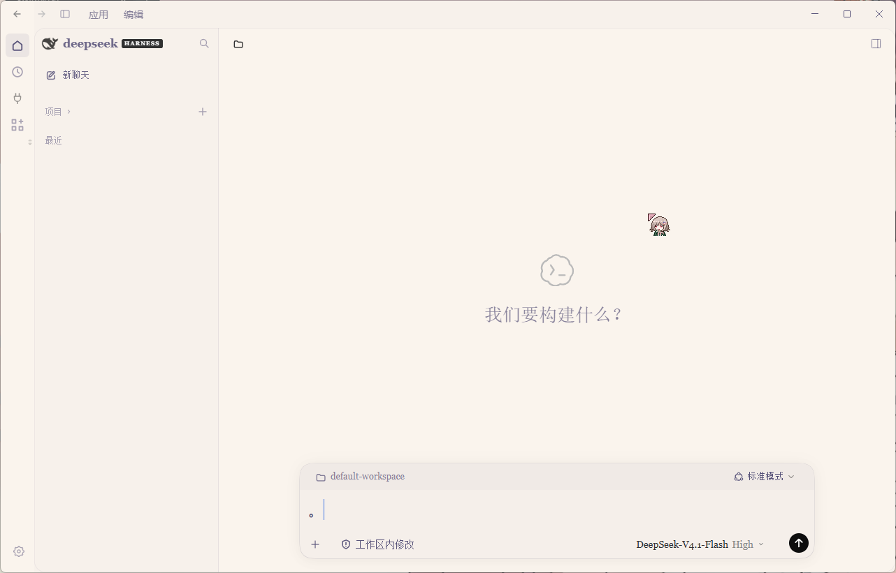
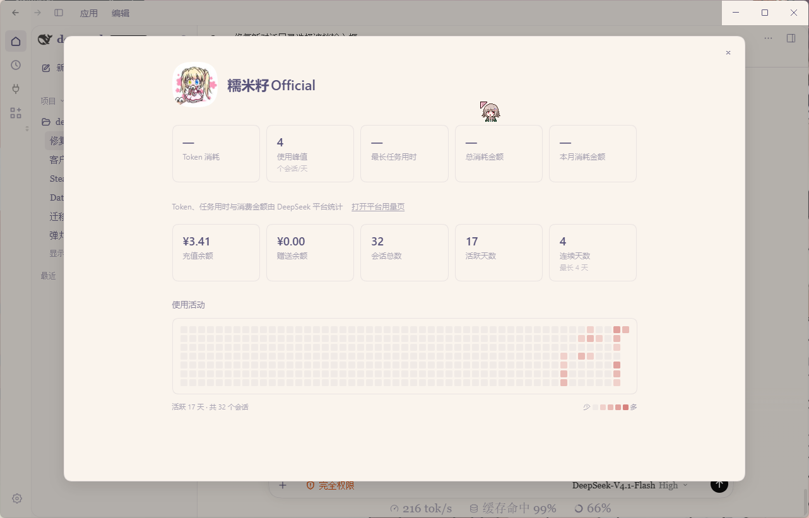
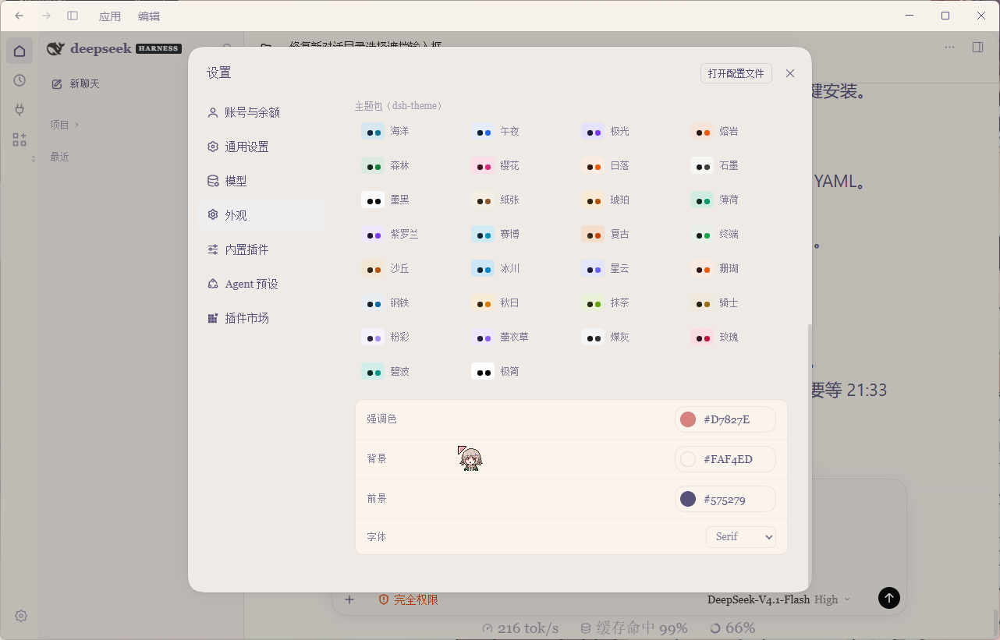

<div align="center">

# DSH Codex Style Enhanced

**A customizable, Codex-inspired workspace for DeepSeek Harness.**

[中文](README.md) · [Download](https://github.com/zianyx6/DSH-Codex-Style/releases) · [Changelog](CHANGELOG.md) · [Feedback](https://github.com/zianyx6/DSH-Codex-Style/issues)


</div>



## Highlights

| Feature | Description |
| --- | --- |
| Workspace | Codex-inspired navigation, collapsible sidebar, project and conversation management, and model controls. |
| Appearance | 30 bundled theme palettes, light/dark/system modes, presets, custom colors, fonts, density and sidebar width. |
| Personal dashboard | Account balance, conversation activity and a 12-month activity heatmap, with links to official usage statistics. |
| Remote workspace | Theme and layout integration for dsh-remote. |
| Conversation experience | Turn duration, collapsible progress, smooth streaming, Markdown and code blocks. |

<p align="center">
  
  
</p>

## Getting started

Windows ZIP installation is recommended:

1. Download the enhanced ZIP from [Releases](https://github.com/zianyx6/DSH-Codex-Style/releases).
2. Fully close DSH and extract the archive.
3. Run `install.cmd` with Node.js 20 or later installed.
4. Restart DSH.

The package name is `@zianyx6/dsh-codex-style-enhanced`. Installation through the DSH plugin page is available once the package is published to the relevant registry.

**Compatibility:** DSH `>=0.2.1-rc.2 <0.3.0-0`. This is the declared loading range, not a guarantee that every host version has been tested. The installer targets Windows; the plugin supports web and desktop clients.

Do not enable the original Codex Style plugin alongside Enhanced. Uninstall the original plugin before installing Enhanced. Existing appearance preferences use compatible storage keys.

See the [installation and maintenance guide](docs/user-guide.md) for migration, updates, rollback and troubleshooting.

## Development

```bash
npm install
npm run build
npm test
```

For bugs and feature requests, use this project's [issue tracker](https://github.com/zianyx6/DSH-Codex-Style/issues). Include your DSH version, plugin version and reproduction steps.

## License and independence

Maintained independently by [@zianyx6](https://github.com/zianyx6), with its own package identity and release process since version 1.0.0. This is not an official DeepSeek or OpenAI product. The original project author is not responsible for Enhanced support or maintenance.

The project is distributed under the [MIT license](LICENSE). Historical code from [DSH-Codex-Style](https://github.com/xinxing1708/DSH-Codex-Style) retains its original copyright notices. Theme data from dsh-theme is licensed under Apache-2.0. See [third-party notices](THIRD_PARTY_NOTICES.md) for full attribution.
