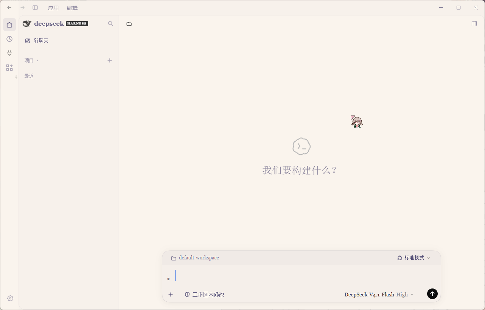
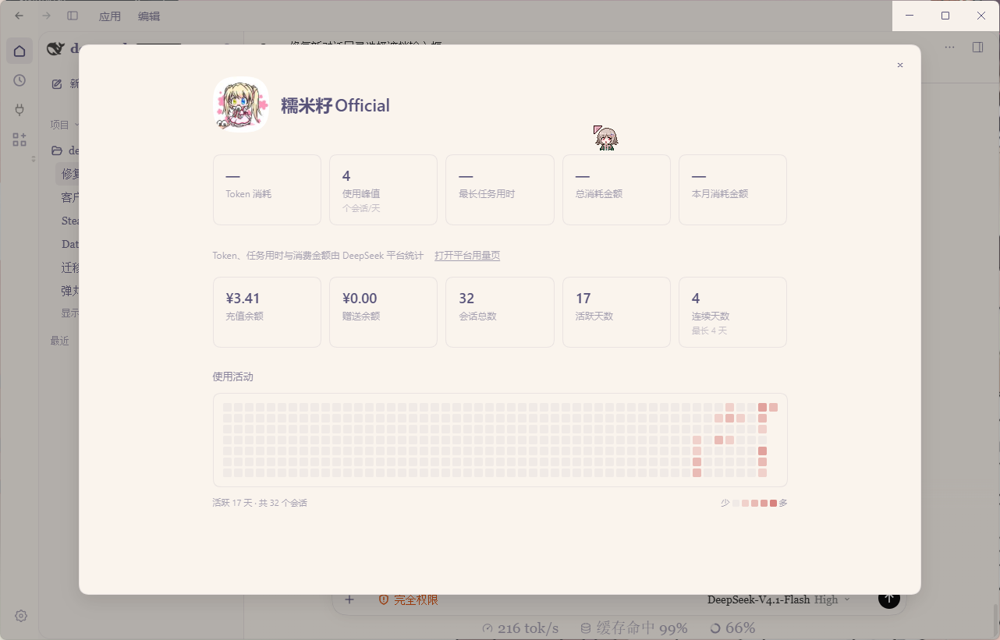
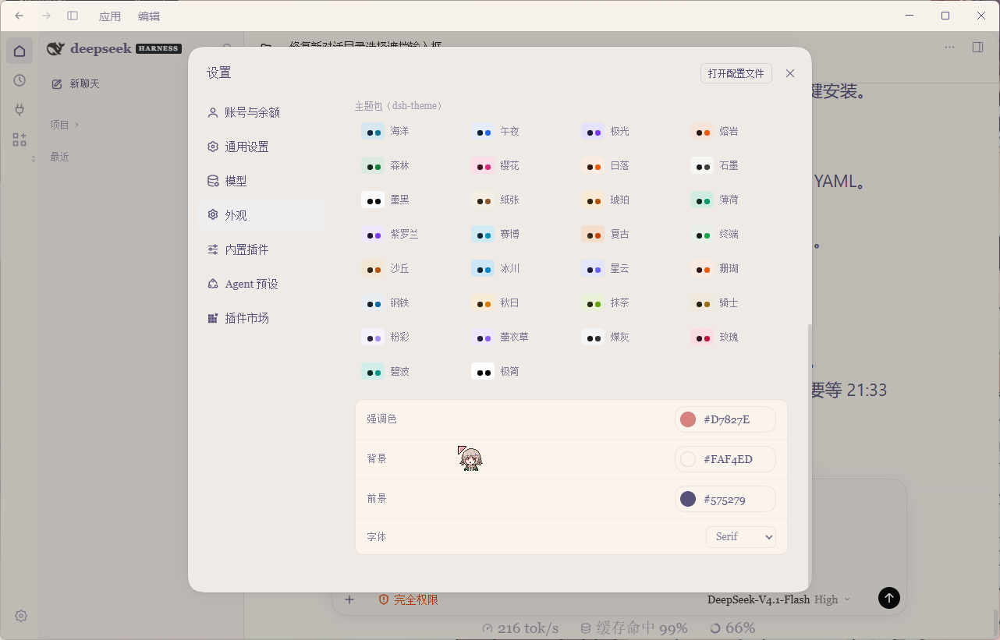
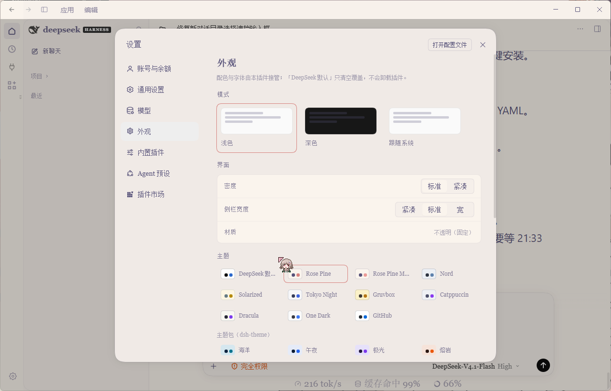

<div align="center">

# DSH Codex Style Enhanced

**为 DeepSeek Harness 打造更完整的桌面工作体验。**

Codex 风格界面 · 个性化外观 · 个人主页 · Remote 工作台

[English](README.en.md) · [下载](https://github.com/zianyx6/DSH-Codex-Style/releases) · [使用指南](docs/user-guide.md) · [更新日志](CHANGELOG.md) · [问题反馈](https://github.com/zianyx6/DSH-Codex-Style/issues)


</div>



## 核心体验

| 功能 | 介绍 |
| --- | --- |
| 桌面工作区 | Codex 风格导航、可收起侧栏、项目与会话管理、模型及权限控制。 |
| 个性化外观 | 内置 30 套主题配色，支持明暗模式、自定义颜色、字体、界面密度与侧栏宽度。 |
| 个人主页 | 查看账号余额、会话统计、近 12 个月活动热力图，并快速进入平台用量页面。 |
| Remote 适配 | 统一 IDE 工作台、文件树、编辑器及弹窗的布局与视觉风格。 |
| 对话体验 | 回合耗时、过程折叠、流式显示、Markdown 与代码块优化。 |

## 界面预览

<p align="center">
  
  
</p>
<p align="center"><sub>个人主页 · 主题选择</sub></p>

<p align="center">
  
</p>
<p align="center"><sub>外观设置</sub></p>

## 快速开始

**Windows ZIP 安装（推荐）**

1. 前往 [Releases](https://github.com/zianyx6/DSH-Codex-Style/releases)，下载增强版 ZIP。
2. 完全退出 DSH，解压安装包。
3. 运行 `install.cmd`（需要 Node.js 20 或更高版本）。
4. 重新启动 DSH。

插件包名：`@zianyx6/dsh-codex-style-enhanced`。待包发布至对应注册表后，也可通过 DSH 插件页安装。

| 环境 | 要求 |
| --- | --- |
| DSH | `>=0.2.1-rc.2 <0.3.0-0` |
| Node.js | 20+（安装器） |
| 平台 | Windows 安装器；Web 与桌面客户端加载 |

> 兼容范围表示允许安装与加载，不代表所有宿主版本均已实机验证。请勿与旧版 Codex Style 同时启用。

旧版迁移、更新、回滚及卸载说明见 [使用指南](docs/user-guide.md)。

## 开发与反馈

```bash
npm install
npm run build
npm test
```

- [问题反馈与功能建议](https://github.com/zianyx6/DSH-Codex-Style/issues)：建议附上 DSH 版本、插件版本、复现步骤及截图。
- [维护文档](docs/maintenance/)：版本策略与兼容性维护。
- [更新日志](CHANGELOG.md)：版本变更及历史记录。

## 关于项目

DSH Codex Style Enhanced 自 1.0.0 起由 [@zianyx6](https://github.com/zianyx6) 独立维护，拥有独立插件标识、安装目录与发布流程。本项目不是 DeepSeek 或 OpenAI 官方产品；历史项目作者不负责本项目的维护与支持。

项目采用 [MIT 许可证](LICENSE)。历史代码来自 [DSH-Codex-Style](https://github.com/xinxing1708/DSH-Codex-Style)，保留原版权声明；主题数据来自 dsh-theme，采用 Apache-2.0 许可。完整署名与许可见 [THIRD_PARTY_NOTICES.md](THIRD_PARTY_NOTICES.md)。
